<!--
  Cards are generated by scripts/render_cards.py (see .github/workflows/cards.yml).
  Don't edit cards/*.svg by hand. To change which repos appear, edit featured.txt
  and the repo block below so the two lists match.
-->

  

  
  
  

  

  

  

  

  

  

